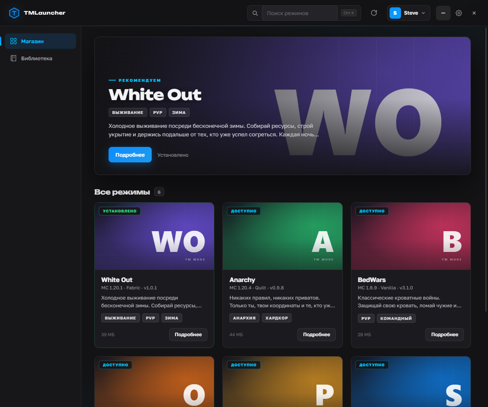
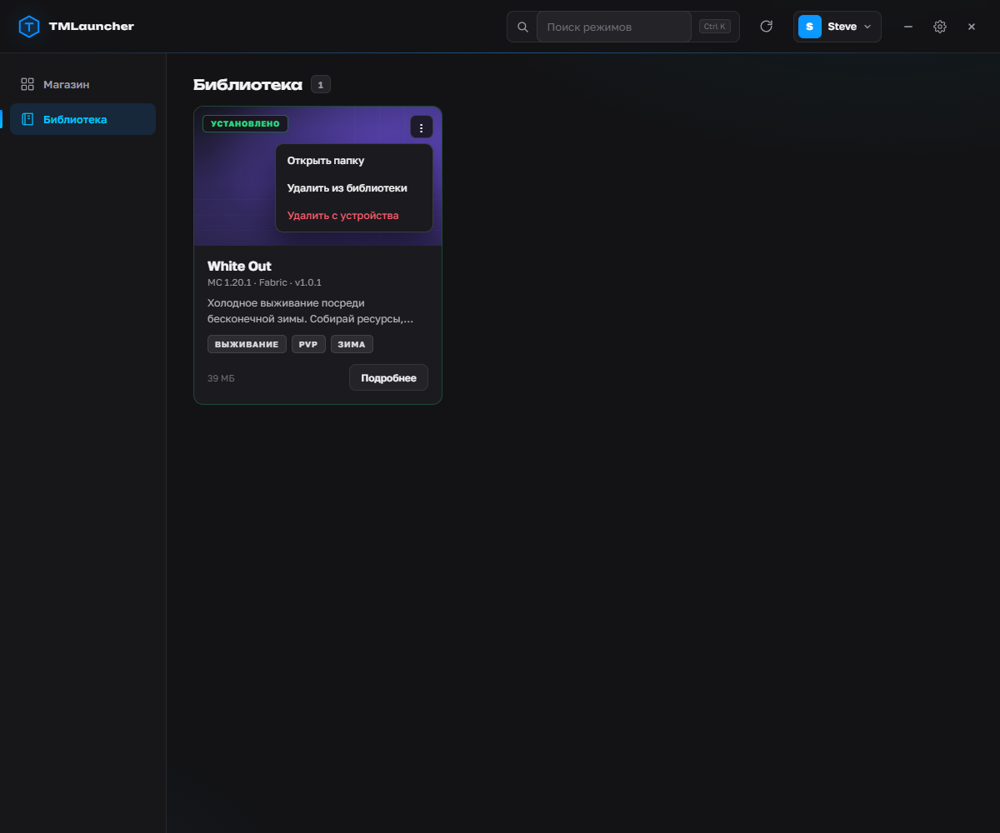
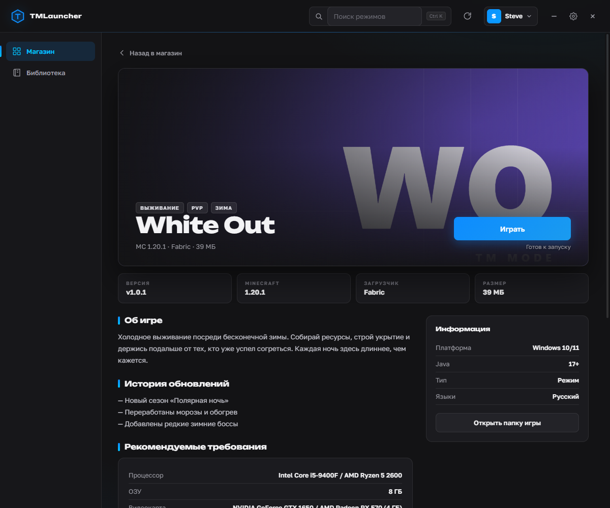
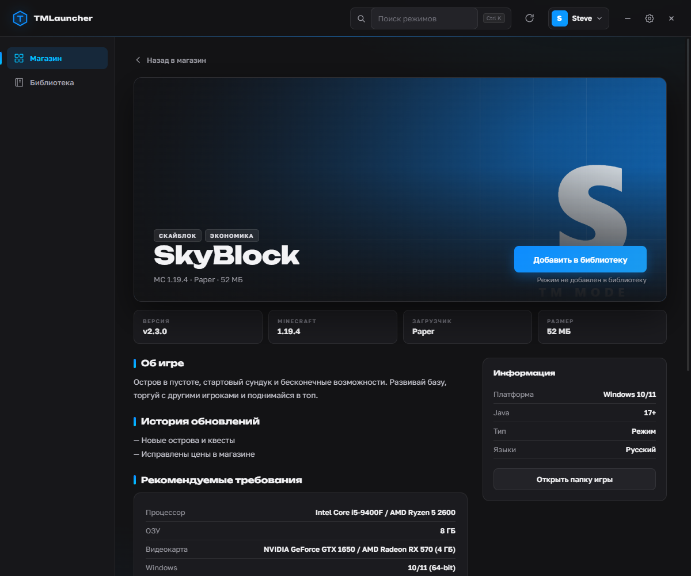
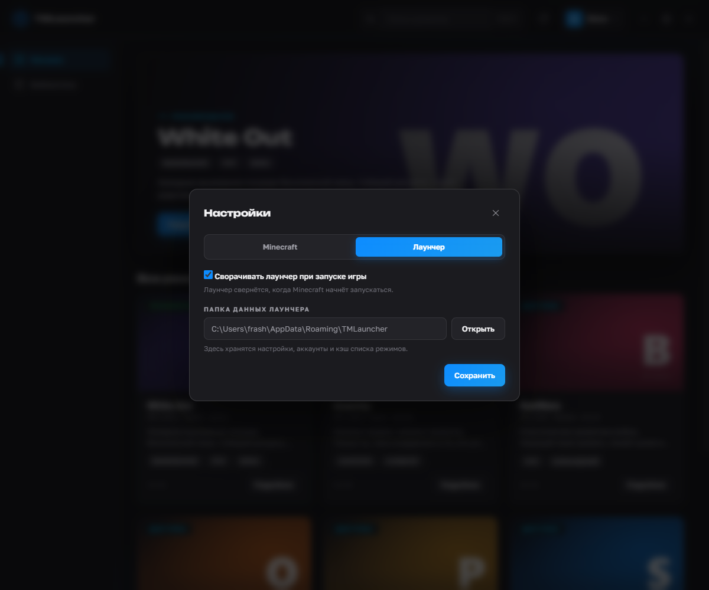
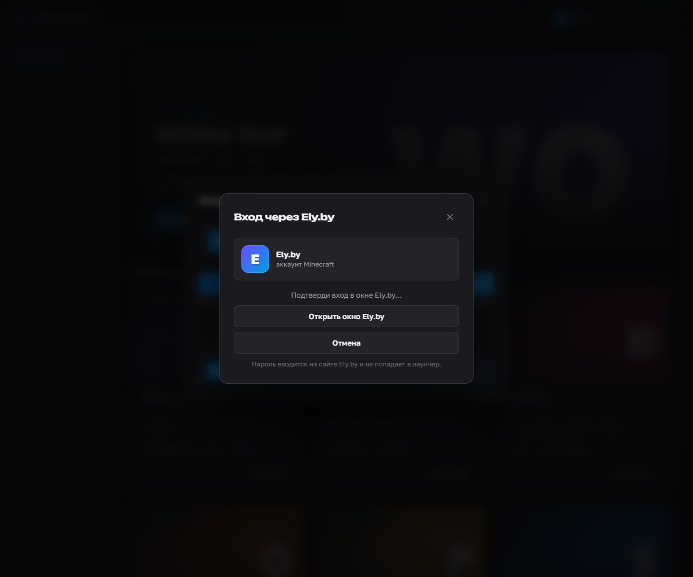

# TMLauncher

Игровой лаунчер для Windows 10/11: витрина режимов в тёмном стиле Epic Games Store, страница игры, аккаунты Ely.by и установка сборок Minecraft. Бэкенд — Rust, интерфейс — Tauri 2 + WebView2.











> На скриншотах показаны демонстрационные режимы, чтобы было видно сетку и страницу игры. В реальном списке отображаются режимы из `modes.json`.

## Что умеет

- **Магазин и библиотека**: слева два раздела. В магазине все режимы, в библиотеке — добавленные вручную или установленные.
- **Добавление в библиотеку**: если режима нет в библиотеке, на странице игры кнопка меняется на **«Добавить в библиотеку»**. Добавление не требует аккаунта; установка и запуск — требуют.
- **Установленные режимы всегда сверху**. На карточке виден статус: «Установлено», «Обновление», «Не установлено» или «В игре».
- **Карточка режима**: обложка, название, версия Minecraft, загрузчик, версия сборки, размер, теги, краткое описание и кнопка **«Подробнее»**.
- **Меню ⋮ в библиотеке**: открыть папку режима, убрать из библиотеки или удалить с устройства. Удаление с устройства оставляет режим в библиотеке.
- **Страница игры в духе Steam/Epic**: большой арт, кнопка добавления/установки/обновления/запуска справа от описания, прогресс, метаданные, описание, история обновлений, системные требования, похожие режимы и переход в папку игры.
- **Вход только через Ely.by**: одна кнопка, отдельное окно с сайтом Ely.by, мультиаккаунт и аватарки со скин-сервера. Логин и пароль в лаунчер не вводятся, офлайн-профили больше не создаются.
- **Скины Ely.by в игре**: лаунчер автоматически подключает `authlib-injector`, чтобы скины работали в Minecraft и на серверах.
- **Инкрементальная установка**: скачиваются только изменённые файлы, удалённые удаляются, sha256 проверяется.
- **Загрузчики**: Vanilla, Forge, Fabric, Quilt, NeoForge.
- **Настройки разделены на Minecraft и Лаунчер**: игра (ОЗУ, папка, Java, окно, JVM-флаги) и лаунчер (сворачивание при запуске, папка данных).
- **Оптимизированные JVM-флаги** (G1GC/Aikar) для более стабильного запуска и меньших лагов. Можно отключить в настройках.
- **Окно лаунчера всегда оконное**: без полноэкранного режима и кнопки разворота. У самой игры fullscreen остаётся.
- Тёмный интерфейс, кастомный титлбар, прогресс-бары и аккуратные тосты.

## Публикация режимов

В лаунчере публикации больше нет — это клиент для игроков. Режимы берутся из GitHub-репозитория (`modes.json`) и кэшируются локально. Выкладывание режимов будет на отдельной площадке.

## Запуск

Двойной клик по **`TMLauncher.bat`** или по **`TMLauncher.exe`**.

`TMLauncher.exe` — standalone-бинарник Tauri. Он использует системный **WebView2**, который уже есть на Windows 10/11. Для запуска игры нужна Java 17+.

Пересобрать портативный exe:

```bat
build-release.bat
```

Собрать установщик:

```bat
build-installer.bat
```

На выходе — `TMLauncher Setup.exe` (NSIS, установка в профиль пользователя, ярлыки и удаление). Портативный `TMLauncher.exe` при этом тоже обновляется.

Установщик нужен для удобства, а не для скорости: интерфейс уже вшит в exe, WebView2 — системный компонент, поэтому распаковка файлов не даёт прироста производительности.

Или вручную:

```bat
cd src-tauri
cargo build --release
```

Для **одного exe без WebView2Loader.dll** нужен MSVC-тулчейн и Visual Studio Build Tools (workload VCTools). `build-release.bat` сам находит MSVC через `vswhere` и собирает в `src-tauri/target-msvc`.

Если MSVC нет, можно собрать GNU-тулчейном, но рядом с exe понадобится `WebView2Loader.dll`.

```bash
rustup default stable
winget install -e --id Microsoft.VisualStudio.2022.BuildTools
```

## Откуда берутся режимы

Список и файлы сборок лежат в GitHub-репозитории [tommy-whinston/TMLauncher](https://github.com/tommy-whinston/TMLauncher). Локально хранятся только установленные сборки и оффлайн-кэш списка.

```
MODES/
├── arts/<id>.png           # арты карточек
└── modes/
    ├── modes.json          # список режимов
    └── <id>/               # файлы сборки (mods/, config/, resourcepacks/...)
        └── manifest.json   # sha256 + размер каждого файла
```

Новые режимы появляются после обновления списка кнопкой **↻** или перезапуска лаунчера.

## Аккаунты

Вход только через **Ely.by**: нажми **«Войти через Ely.by»** — откроется отдельное окно с сайтом Ely.by. Войди в аккаунт и подтверди вход, после чего лаунчер сам получит токен. Логин и пароль в лаунчер не вводятся и не сохраняются — локально хранится только токен.

Для OAuth используется вшитый публичный `client_id` **`tm-launcher`** — отдельного поля в настройках нет.

Вход сохраняется навсегда: refresh-токен автоматически обновляет доступ при запуске. Заново входить нужно только если токен отозван или удалён.

Старые офлайн-аккаунты, если они уже были сохранены, остаются в списке: их можно выбрать или удалить, но новый офлайн-вход больше не создаётся.

Токены хранятся локально в `%APPDATA%\TMLauncher\accounts.json`.



## Скины Ely.by

Для Ely-аккаунтов лаунчер при запуске добавляет `authlib-injector` и указывает ему `ely.by`. Благодаря этому в игре работают скины Ely.by и авторизация на серверах. Jar-файл скачивается один раз и кэшируется в папке игры как `authlib-injector.jar`.

## Производительность

В настройках есть пункт **«Оптимизированные JVM-флаги (G1GC)»**. Он добавляет G1GC и настройки Aikar: меньше лагов, стабильнее работа с памятью и предсказуемый запуск. Если сборка или Java несовместимы с флагами, пункт можно отключить.

## Файлы и данные

| Путь | Назначение |
|---|---|
| `src/index.html` | разметка витрины, страницы игры и модалок |
| `src/styles.css` | тёмный дизайн в духе Epic Games Store |
| `src/app.js` | логика витрины, деталей, аккаунтов и настроек |
| `src/bridge.js` | мост `window.tm` → Tauri-команды |
| `src-tauri/src/main.rs` | точка входа Tauri и регистрация команд |
| `src-tauri/src/commands.rs` | Tauri-команды |
| `src-tauri/src/game.rs` | синк сборки, установка загрузчиков, запуск Java |
| `src-tauri/src/net.rs` | GitHub: `modes.json`, `manifest.json`, скачивание файлов |
| `src-tauri/src/auth.rs` | Ely.by OAuth device flow, validate/refresh |
| `src-tauri/src/store.rs` | настройки, аккаунты, refresh-токены и состояние в JSON |
| `src-tauri/src/models.rs` | модели данных |
| `src-tauri/tauri.conf.json` | окно 1200×740, без decorations/maximize/fullscreen |
| `build-release.bat` | MSVC-сборка и копирование exe в корень |
| `build-installer.bat` | сборка NSIS-установщика `TMLauncher Setup.exe` |
| `legacy-egui/` | предыдущая egui-версия, сохранена |
| `legacy-electron/` | самая первая Electron-версия, сохранена |

Данные приложения:

- `%APPDATA%\TMLauncher\` — настройки, аккаунты, refresh-токены и кэш списка режимов. При первом запуске данные автоматически переносятся из `%APPDATA%\TM Launcher\` или старой `%APPDATA%\TDEV Launcher\`.
- `%APPDATA%\.tdevlauncher\` — игра: `versions/`, `libraries/`, `assets/`, `games/<id>/`, `authlib-injector.jar`. Папка оставлена с прежним именем, чтобы не потерять уже установленные сборки.

## Java

Нужна Java 17+ в системе (или путь к ней в настройках). Для Forge лаунчер сам запускает installer через Java; для Fabric/Vanilla Java нужна только при запуске игры.

## Платформа

- Только **Windows 10/11 x64**.
- Лаунчер оконный, без разворота на весь экран; настройка fullscreen относится к игре.
- Один exe при MSVC-сборке; WebView2 — системный компонент Windows.
