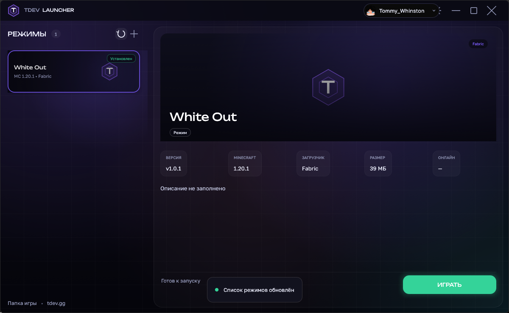

# TDEV Launcher (Rust)

Майнкрафт-лаунчер с режимами-карточками, аккаунтами Ely.by и инкрементальными обновлениями сборок. Полностью переписан на Rust: интерфейс на `egui`/`eframe`, без Electron и без WebView2.



## Что умеет

- Список режимов из GitHub-репозитория (`modes.json`) + оффлайн-кэш.
- Аккаунты **Ely.by** (Yggdrasil API), оффлайн-профили, мультиаккаунт, аватарки со скин-сервера.
- Инкрементальная установка сборки: скачиваются только изменённые файлы, удалённые — удаляются, sha256 проверяется.
- Загрузчики **Vanilla / Forge / Fabric** (Forge и Fabric ставятся через `mc-launcher-core`).
- Запуск игры с выбранным объёмом ОЗУ, размером окна и полноэкранным режимом.
- Публикация режима прямо из лаунчера: zip → пофайловая заливка в GitHub, `manifest.json`, арт, `modes.json`.
- Тёмный интерфейс с кастомным титлбаром, карточками, прогрессом и тостами.

## Запуск

Двойной клик по **`TDEV Launcher.bat`**.

Если релизный exe ещё не собран, скрипт сам вызовет `cargo build --release`. Для сборки нужен Rust:

```bash
rustup default stable
# Windows GNU-тулчейн (как в этом проекте):
winget install -e --id BrechtSanders.WinLibs.POSIX.UCRT
cargo build --release
```

Можно использовать и MSVC-тулчейн — `.cargo/config.toml` с настройками GNU в этом случае просто не применяется.

Запуск из терминала:

```bash
cargo run --release
```

## Откуда берутся режимы

Только из GitHub-репозитория (по умолчанию `nodura1488-sudo/MODES`). Локально хранятся только установленные сборки и оффлайн-кэш списка.

```
MODES/
├── modes.json              # список режимов
├── arts/<id>.png           # арты карточек
└── modes/<id>/             # файлы сборки (mods/, config/, resourcepacks/...)
    └── manifest.json       # sha256 + размер каждого файла
```

Новые режимы появляются после обновления списка кнопкой **↻** или перезапуска.

## Публикация режима

1. Создай GitHub-токен: [github.com/settings/tokens/new](https://github.com/settings/tokens/new?scopes=repo&description=TDEV%20Launcher) с галочкой **repo**.
2. Нажми **«+»** в лаунчере: репозиторий, токен, название, версия, MC-версия, загрузчик, описание, арт и zip сборки.
3. **ОПУБЛИКОВАТЬ** — лаунчер распакует zip, посчитает sha256, зальёт файлы в `modes/<id>/`, манифест, арт и обновит `modes.json`.

## Аккаунты

Вход по логину/паролю **Ely.by**, офлайн-профили, переключение и удаление аккаунтов. Токены хранятся локально в `%APPDATA%\TDEV Launcher\accounts.json`.

## Файлы и данные

| Путь | Назначение |
|---|---|
| `src/main.rs` | точка входа, окно, иконка |
| `src/app.rs` | весь интерфейс и состояние приложения |
| `src/game.rs` | синк сборки, установка загрузчиков, запуск Java |
| `src/net.rs` | GitHub: modes.json, manifest.json, git tree, скачивание |
| `src/publish.rs` | публикация режима в GitHub |
| `src/auth.rs` | Ely.by authenticate/validate/refresh, офлайн-UUID |
| `src/store.rs` | настройки/аккаунты/состояние в JSON |
| `src/images.rs` | загрузка и кэш артов/аватарок |
| `src/theme.rs` | цвета, шрифты, градиенты, свечения |
| `src/widgets.rs` | кастомные кнопки, поля, прогресс, аватарки |
| `assets/fonts/` | Golos Text и Unbounded (кириллица) |
| `legacy-electron/` | старая Electron-версия, сохранена для истории |

Данные приложения:

- `%APPDATA%\TDEV Launcher\` — настройки, аккаунты, кэш списка режимов.
- `%APPDATA%\.tdevlauncher\` — игра: `versions/`, `libraries/`, `assets/`, `games/<id>/`.

## Java

Нужна Java 17+ в системе (или путь к ней в настройках). Для Forge лаунчер сам запускает installer через Java; для Fabric/Vanilla Java нужна только при запуске игры.
